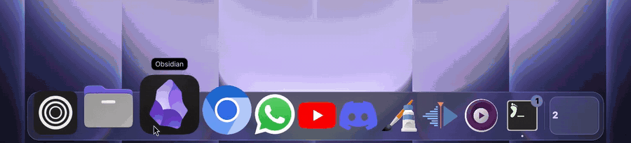
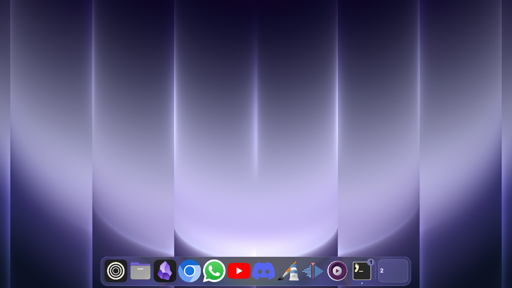

<div align="center">

# Glass Dock

**The macOS dock, on Omarchy.**
Icons that swell under your pointer, one dock per screen, and real refractive glass.



</div>



## Why this one

- 🔍 **Magnification that follows the pointer**, smooth like macOS, with the app
  name floating above.
- 🧊 **Real Liquid Glass.** Not a blur: the desktop bends through the dock's edges
  (with the [Liquid Glass](https://github.com/fasi96/omarchy-liquid-glass) plugin;
  one switch in the dock's panel).
- 🖥️ **One dock per screen**, each with its own monitor's workspaces on the right,
  showing the icons of the windows on each. Click to jump, scroll to step through them.
- ➖ **Minimize to the dock.** Click a focused app to minimize it, click again to
  bring it back. Like the Windows taskbar, but prettier.
- 📌 **Pin, drag, reorder.** Drag icons around; drop a running app among the pinned
  ones to keep it. Drag a pinned icon out to remove it.
- 🌙 **Knows what is still running.** Apps whose window you closed but that keep
  running in the background stay in the dock with a dot.
- 🫥 **Gets out of the way.** Optional auto-hide with a reveal delay, a compact mode
  that shrinks the dock when the pointer leaves, and it reserves its own space so
  tiled windows never end up underneath it.
- 🗂️ **Right-click menu**: new window, move to another workspace, minimize, restore,
  close windows, quit the app.
- 🌍 English and Portuguese, following your system language.

## Install

```bash
omarchy plugin add https://github.com/hugorolimf/omarchy-dock --enable
omarchy-restart-shell
```

The dock is a `keepLoaded` panel, so the shell has to restart once after
installing or updating it. Then add the **Dock** widget to the bar (Omarchy
menu → bar settings) to reach its settings.

## Requirements

- Omarchy with the Quattro shell (Quickshell) and Hyprland's Lua config.
- Optional: [Liquid Glass](https://github.com/fasi96/omarchy-liquid-glass) for the
  glass effect. Without it the dock uses a translucent plate.

Nothing else is installed and no system file is touched.

## Files it writes

- `~/.local/state/omarchy/io.github.hugorolimf.dock/`: pinned apps, settings, and
  the height each dock covers on its monitor.
- `~/.local/state/omarchy/toggles/hypr/hugorolimf-dock-glass.lua`: only while
  Liquid Glass is switched on from the dock's panel. Omarchy loads files in this
  folder on every Hyprland reload; switching the glass off deletes it.

## Window scripts (optional)

On a stock Omarchy the dock reserves its height, so tiled windows stop above it,
and it uses plain Hyprland dispatchers to focus, minimize (to
`special:minimized`) and close windows.

If your Hyprland Lua config defines any of these global functions, the dock calls
them instead and stops reserving space (your script is then expected to keep
windows clear of the dock, reading `cover-<monitor>` in the state folder):

| Function | Called when |
|---|---|
| `windowing_raise(address)` | focusing a window |
| `windowing_minimize(address)` | minimizing from the dock |
| `windowing_quit(class)` | Quit from the right-click menu |
| `windowing_refit(monitor)` | the dock shows or hides |

A script may also write `address workspace monitor` lines to
`<state folder>/maximized`; the dock then hides while such a window fills its
monitor.

## Remove

```bash
omarchy plugin remove io.github.hugorolimf.dock
rm -rf ~/.local/state/omarchy/io.github.hugorolimf.dock
rm -f ~/.local/state/omarchy/toggles/hypr/hugorolimf-dock-glass.lua && hyprctl reload
omarchy-restart-shell
```

## License

[MIT](LICENSE) © Hugo Rolim Filho
