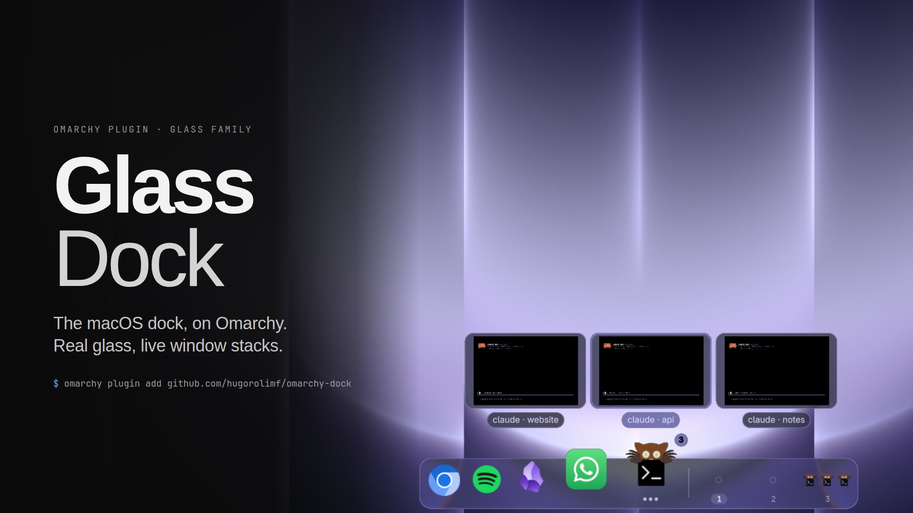
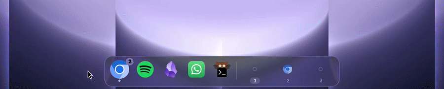
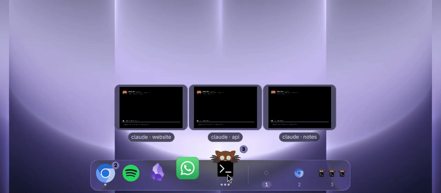
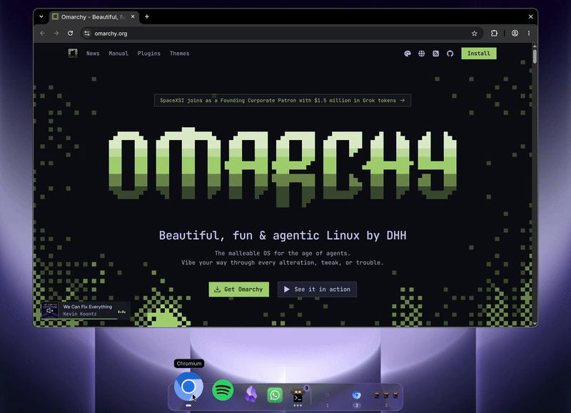
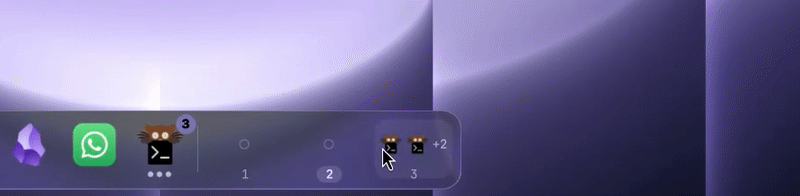
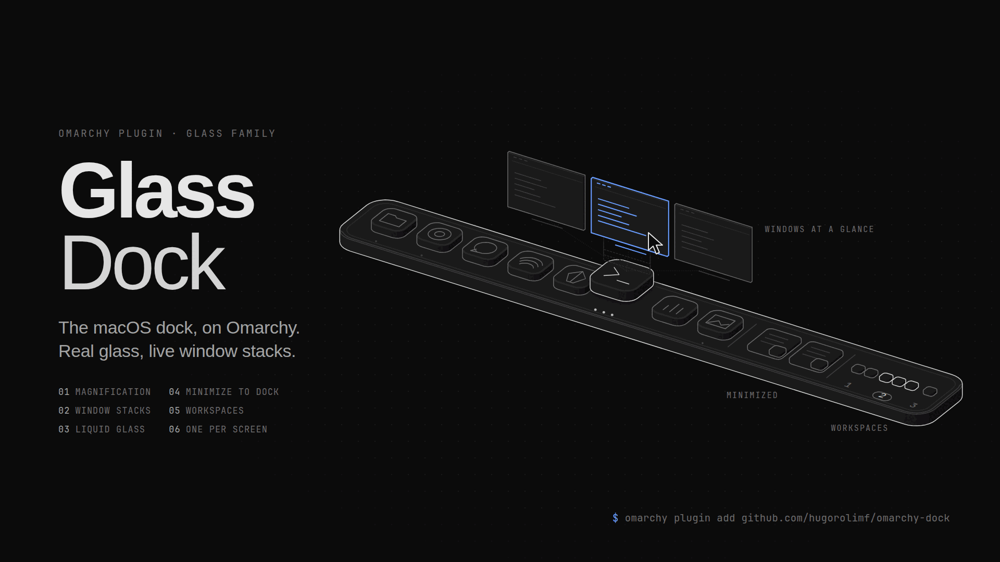

<div align="center">

# Glass Dock

**The macOS dock, on Omarchy.**
Icons that swell under your pointer, one dock per screen, and real refractive glass.



</div>

**▶ [Watch the 2-minute tour](https://github.com/hugorolimf/omarchy-dock/releases/download/v1.2.0/glass-dock-tour.mp4)**, recorded on a real desktop, mouse included.

## Why this one

- 🔍 **Magnification that follows the pointer**, smooth like macOS, with the app
  name floating above.
- 🧊 **Real Liquid Glass.** Not a blur: the desktop bends through the dock's edges
  (with the [Liquid Glass](https://github.com/fasi96/omarchy-liquid-glass) plugin;
  one switch in the dock's panel).
- 🖥️ **One dock per screen**, each with its own monitor's workspaces on the right,
  showing the icons of the windows on each. Click to jump, drag one onto another to
  swap them.
- ➖ **Minimize into the dock.** Like macOS, a minimized window becomes a thumbnail
  of its own at the right end of the dock; click it to bring the window back.
  Clicking a focused app minimizes it too, like the Windows taskbar.
- 📌 **Pin, drag, reorder.** Drag icons around; drop a running app among the pinned
  ones to keep it. Drag a window onto a workspace in the dock to move it there (this
  one needs a [window script](#window-scripts-optional)).
- 🃏 **Every window, at a glance.** One dot per open window under each icon. Rest the
  pointer on an app with several windows and they rise above its icon as live
  thumbnails: click the one you want.
- 🪟 **Show all windows.** The right-click menu lists the app's windows by title and
  opens an App Exposé of them.
- 🌙 **Knows what is still running.** Apps whose window you closed but that keep
  running in the background stay in the dock with a dot.
- 🫥 **Gets out of the way.** Optional auto-hide, a compact mode that shrinks the
  dock when the pointer leaves, and it reserves its own space so tiled windows never
  end up underneath it.
- 🗂️ **Right-click menu**: the app's windows, show all windows, new window, move to
  another workspace, minimize, restore, close windows, quit the app.
- 🌍 English and Portuguese, following your system language.

## See it

**Magnification** follows the pointer across the dock.



**Every window, at a glance**: rest the pointer on an app and its windows rise above
the icon as live thumbnails.



**Minimize into the dock**: the window goes down and becomes a thumbnail at the right
end.



**Workspaces** show the icons of their windows. Click to jump, drag one onto another
to swap them.



## The parts



## Install

```bash
omarchy plugin add https://github.com/hugorolimf/omarchy-dock --enable
omarchy-restart-shell
```

The dock is a `keepLoaded` panel, so the shell has to restart once after
installing or updating it. Then add the **Dock** widget to the bar (Omarchy
menu → bar settings) to reach its settings.

## Requirements

- Omarchy with the Quattro shell (Quickshell) and Hyprland's Lua config.
- Optional: [Liquid Glass](https://github.com/fasi96/omarchy-liquid-glass) for the
  glass effect. Without it the dock uses a translucent plate.

Nothing else is installed and no system file is touched.

## Files it writes

- `~/.local/state/omarchy/io.github.hugorolimf.dock/`: pinned apps, settings, the
  height each dock covers on its monitor, and where its workspace tiles are.
  A file named `vitrine` there (workspace ids, like `21=1 22=2`), which you create
  by hand, limits the dock to those workspaces and renames them; it is how the demo
  was recorded on a clean desktop. Without it nothing changes.
- `~/.local/state/omarchy/toggles/hypr/hugorolimf-dock-glass.lua`: only while
  Liquid Glass is switched on from the dock's panel. Omarchy loads files in this
  folder on every Hyprland reload; switching the glass off deletes it.

## Window scripts (optional)

On a stock Omarchy the dock reserves its height, so tiled windows stop above it,
and it uses plain Hyprland dispatchers to focus, minimize (to
`special:minimized`) and close windows.

If your Hyprland Lua config defines any of these global functions, the dock calls
them instead and stops reserving space (your script is then expected to keep
windows clear of the dock, reading `cover-<monitor>` in the state folder: two
numbers, the height the dock covers right now (0 while it hides) and its line,
the height ordinary windows should stay above even while the dock steps aside for
a maximized window; 0 only when auto-hide is on):

| Function | Called when |
|---|---|
| `windowing_raise(address)` | focusing a window |
| `windowing_minimize(address)` | minimizing from the dock |
| `windowing_quit(class)` | Quit from the right-click menu |
| `windowing_refit(monitor)` | the dock shows or hides, or its line moves |

Dragging a window onto a workspace tile needs a script too. It watches the drag and
writes `seq phase address ws cx cy fx fy fw fh` lines to `<state folder>/drag`; the
dock shows itself when a drag starts and lists its tiles in `tiles-<monitor>`
(`id x y w h`, global pixels). Without such a script the rest of the dock works the same.

A script may also write `address workspace monitor` lines to
`<state folder>/maximized`; the dock then hides while such a window fills its
monitor.

## Remove

```bash
omarchy plugin remove io.github.hugorolimf.dock
rm -rf ~/.local/state/omarchy/io.github.hugorolimf.dock
rm -f ~/.local/state/omarchy/toggles/hypr/hugorolimf-dock-glass.lua && hyprctl reload
omarchy-restart-shell
```

## License

[MIT](LICENSE) © Hugo Rolim Filho
